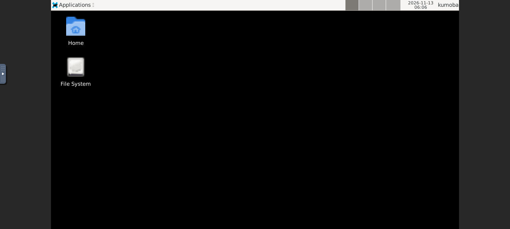

# kumoba CLI

`kumoba` drives a `kumobad` daemon from a shell, for people and for agents. It has no command list of its own: it asks the daemon (`GET /v1/commands`) which commands exist, what arguments each takes, and what it prints. A newer daemon's commands show up in an older CLI without an upgrade, and the help is always the daemon's.

There are two builds with the same behaviour:

| Build | Install |
| --- | --- |
| Native, no runtime needed | `scripts/install.sh` puts it in `~/.kumoba/bin`; also `cargo install kumobad` |
| Node.js 20 or later | `npm install -g kumoba`, or `npx kumoba <command>` |

## Connecting

With no settings it uses the zero-config daemon in `~/.kumoba`: the socket `kumobad.sock` and the token `token`. Override with:

| Variable | Default |
| --- | --- |
| `KUMOBA_URL` | `unix://$KUMOBA_HOME/kumobad.sock`; `http://127.0.0.1:7788` also works |
| `KUMOBA_TOKEN` or `KUMOBA_TOKEN_FILE` | `$KUMOBA_HOME/token` |
| `KUMOBA_HOME` | `~/.kumoba` |

## Finding commands

```sh
kumoba                       # every command, with a one-line summary
kumoba exec --help           # one command: usage, arguments, types, defaults
kumoba help exec             # the same
kumoba commands --json       # every command with its full JSON Schema, for agents
kumoba version               # this CLI and the daemon
```

The commands a 0.2 daemon serves:

| Command | What it does |
| --- | --- |
| `run` | Run one command in a fresh sandbox, stream its output, delete the sandbox |
| `create`, `start`, `stop`, `delete` | Sandbox lifecycle; `create` leaves it stopped |
| `list`, `get`, `update` | Find sandboxes by label, show one, change labels, timers or network |
| `exec` | Run a command in a started sandbox and stream its output |
| `read-file`, `write-file`, `list-files` | Guest files |
| `expose` | A signed, expiring link to a port inside the sandbox |
| `desktop` | Start the desktop and link to a live view in the browser |
| `set-secrets`, `delete-secrets` | Secrets that never enter the guest |
| `images`, `access-log` | Bootable images, and every proxied network connection |

## Arguments

Every command reads its arguments the same way, checked against its schema:

```sh
kumoba exec <id> --timeout-ms 5000 -- python3 -c 'print(1)'   # positional, flag, trailing list
kumoba exec <id> timeoutMs=5000 -- python3 -c 'print(1)'      # key=value works too
kumoba create --image default --memory-mib 2048 --network.mode allowlist --network.hosts pypi.org,files.pythonhosted.org
kumoba create --args '{"image":"default","labels":{"team":"qa"}}'
```

- **Positional values** fill the command's path arguments in order, such as the sandbox id.
- **`--kebab-case value`**, `--kebab-case=value` and `camelCase=value` set any argument. A boolean flag needs no value.
- **Everything after `--`** is the command's trailing list: the program and arguments for `run` and `exec`. A program without a `/` is looked up on the guest's `PATH`.
- **Types** come from the schema: integers and booleans are checked, enums list their choices, `null` clears a nullable value.
- **Lists** take `a,b`, a repeated flag, or a JSON array.
- **Maps** such as `env` and `labels` take repeated `key=value`: `--env A=1 --env B=2`.
- **Nested objects** take dotted names (`--network.mode`) or JSON.
- **`@file`** reads a value from a file and **`@-`** from stdin, so secrets stay out of shell history: `env=TOKEN=@token.txt`. Start a value with `@@` for a literal `@`.
- **`--args '{...}'`** passes all arguments as one JSON object.

## Output

| Kind | Commands | What you get |
| --- | --- | --- |
| JSON | most | Pretty JSON on a terminal, one line of JSON when piped or with `--json`. `-q` prints only the `id`s, one per line |
| Stream | `run`, `exec` | The guest's stdout and stderr on yours, as they arrive |
| Bytes | `read-file` | The file on stdout, or into `-o FILE` |

`write-file` reads the file content from `content=@path`, or from stdin when it is piped.

`--open` opens a returned `url` in your browser. That is how `kumoba desktop <id> --open` shows the desktop live and `kumoba expose <id> --port 3000 --ttl-seconds 600 --open` opens a web app running in the sandbox. Those links point at the daemon's preview listener, which the zero-config daemon starts on `127.0.0.1:7789`, apart from its API. A daemon configured by hand needs `KUMOBAD_PREVIEW_LISTEN`, and behind a reverse proxy `KUMOBAD_PREVIEW_URL`.



## Exit status

| Status | Meaning |
| --- | --- |
| The guest's own | `run` and `exec` exit with the command's exit code; 124 when it timed out |
| 0 | Success |
| 1 | The daemon rejected the request: unknown sandbox, bad state, invalid value |
| 2 | Usage error: unknown command or option, missing argument, wrong type |
| 3 | The daemon cannot be reached, has no token yet, or is too old to describe its commands |

Errors go to stderr as one line starting with `kumoba:`.

## For agents

An agent with a shell needs nothing beyond the CLI:

```sh
kumoba commands --json | jq '.commands[] | {name, summary}'
id=$(kumoba create --image default --labels task=fix-tests -q)
kumoba start "$id" -q
kumoba exec "$id" --cwd /workspace -- pytest -q; echo "exit $?"
kumoba list --label task:fix-tests --json
```

Each command's `inputSchema` in `kumoba commands --json` is a JSON Schema, so it can be handed to a model as a tool definition as is.

## Examples

```sh
kumoba run --image default --network.mode blocked -- python3 -c 'print(sum(range(10)))'
kumoba run --timeout-ms 2000 -- sleep 5; echo $?          # 124

id=$(kumoba create --image default -q); kumoba start "$id" -q
kumoba write-file "$id" --path /workspace/data.csv content=@./data.csv
kumoba exec "$id" --cwd /workspace -- python3 -c 'import csv; print(sum(1 for _ in open("data.csv")))'
kumoba read-file "$id" --path /workspace/out.png -o out.png
kumoba set-secrets "$id" secrets=@./secrets.json
kumoba access-log --json | jq '.entries[] | select(.decision == "denied")'
kumoba stop "$id" && kumoba delete "$id"
```
